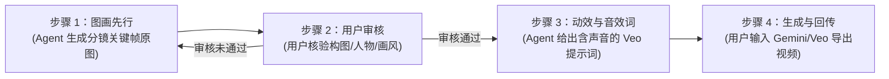
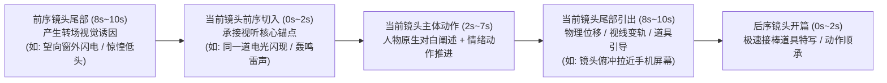
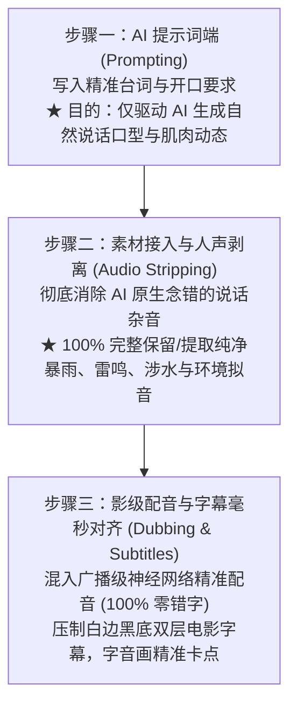

# 本地 Agent 生产铁律：全局视觉风格与人机协作 SOP 规范

> **适用范围**：微电影《第七张罚单》全片 23 镜头视频与图像生成  
> **核心原则**：**画风绝对统一 · 流程标准规范 · 声画同步原生 · 单步审核交付**

---

## 🚨 核心铁律一：视觉画风绝对统一（锁死新海诚动漫写实）

1. **绝对画风锚定（锁定为：新海诚高质感写实动漫 / 影视概念艺术）**：
   * **严禁真人实拍/3D写实化**：严禁把角色渲染成三次元真人实拍皮肤质感或欧美 3D CGI 偶动画风格；
   * **全片基调对齐**：必须与已成功定稿的 `assets/videos/shot_02_lao_liu_scooter_rain.mp4` 和 `assets/videos/shot_01_macro_city_to_lu_yuan_monologue.mp4` 保持完全一致的二次元写实动漫质感（精致手绘感光影、赛璐珞高光、柔和动漫边缘、水彩背景与雨夜霓虹冷暖光）。

2. **每条提示词（Prompt）必带的风格硬性约束咒语**：
   未来提供的所有中英文提示词，必须在前置和后置强行注入以下锁风指令：
   * **中文必带锁**：
     > `【画风严格对齐要求】：必须严格保持与参考图片 100% 完全一致的“新海诚高质感写实动漫/影视概念艺术风格”！严禁改变画风，绝对严禁生成真人实拍质感！人物五官、发型、黑框眼镜及服饰必须与参考图完全一致。`
   * **英文必带锁**：
     > `Strict style consistency: Must strictly maintain the exact same Makoto Shinkai anime realism concept art style as the reference image. Absolutely NO photorealistic human skin, NO live-action film style. Consistent 2D/2.5D stylized anime aesthetics.`

---

## 🔊 核心铁律二：声音、对白与音效全链路同步规范（强制写入 Prompt）

我们制作的是**全声画同步微电影**，Gemini / Veo 原生支持丰富的音频生成。所有视频生成提示词必须显式包含三层声音设计：

1. **显式注入三层声音体系**：
   * **第一层·角色对白/画外音（Dialogue / Voiceover）**：必须指明说话者、具体台词文本、语速和情绪基调（如：“冷酷刺耳的系统机械女声”、“疲惫沙哑的自语”、“沉稳内敛的男声独白”）。
   * **第二层·核心事件音效（Key SFX）**：关键道具或动作发生的瞬间音效（如：“倒计时蜂鸣滴答变奏”、“超时刺耳警报”、“鼠标重重点击声”、“低音轰鸣 Sub-bass drop”）。
   * **第三层·环境拟音（Foley & Ambience）**：宏观氛围声音（如：“密集的暴雨倾盆声”、“雨水飞溅在手机屏幕的啪嗒声”、“电动车涉水破浪的浪花声”、“远方沉闷雷鸣”）。

2. **视频生成 Prompt 强制附带 `Audio & Sound Design` 模块**：
   未来给出的每一条英文 Prompt，必须单独列出 `Audio & Sound Design:` 段落，确保 Gemini / Veo 在生成物理画面的同时生成相匹配的原生音轨。

---

## 🛠️ 核心铁律三：逐镜头四步人机协作生产 SOP（严格执行）

为确保每一帧画质与动态完全符合导演要求，后续所有分镜必须严格遵循以下 **四步生产流水线**：

1. **步骤一（图画先行）**：
   * 针对尚未完成分镜图片的镜头，Agent 优先生成 16:9 高清关键帧原图并保存至 `assets/images/`，呈交预览链接。
2. **步骤二（用户审核）**：
   * 用户审核关键帧的构图、人物表情、道具细节及风格一致性。
   * **未通过**：Agent 立即根据用户意见重新生成或调整图片，严禁跳步生成视频。
   * **通过**：进入步骤三。
3. **步骤三（动效与音效提示词输出）**：
   * 仅在图片审核通过后，Agent 方可为该镜头量身定制包含**视觉动态 + 原生对白 + 拟音音效**的 Gemini / Veo 中英文提示词。
4. **步骤四（视频生成与回传归档）**：
   * 用户将审核通过的图片作为首帧/参考底图，连同 Prompt 提交至 Gemini / Veo 生成视频；
   * 用户将生成的 MP4 视频保存至 `assets/videos/`，Agent 立即跟进音画校验、对白字幕与无缝拼接入正片序列。

---

## 🎬 核心铁律五：前后镜头视听衔接与动态转场规范（Match Cut & Continuity）

为杜绝分镜割裂、死板拼接与跳切问题，**全片所有后续镜头（包括柳锐凯负责的前三幕与芮凯负责的后两幕）必须强制遵循“黄金三段式视听衔接法则”**：

### 1. 黄金三段式视听衔接法则（Tri-phase Continuity Framework）
每个镜头的脚本设计与 AI 提示词中，必须显式明确以下三个阶段：
* **阶段一·前序切入点（In-Transition，0s ~ 2s）**：
  * 必须承接上一镜头结尾的视觉核心锚点或声学余音。严禁无缘由硬跳！
  * *范式*：上一镜落地窗外白色闪电划过 $\rightarrow$ 本镜街头同一道夜空闪电照亮老刘；上一镜代码报错红框 $\rightarrow$ 本镜工位警报红光闪烁。
* **阶段二·主体叙事与微动作（In-Shot Core Action & Dialogue，2s ~ 7.5s）**：
  * 人物在运动中进行原生对白陈述，嘴唇张合口型自然契合；
  * 光影、雨水物理与环境氛围随角色情绪有机律动（如：车身颠簸震颤、屏幕红光漫反射）。
* **阶段三·尾部引导动作与视角位移（Out-Transition & Handoff，7.5s ~ 10s）**：
  * 在台词收尾瞬间，人物必须产生一个**明确的视觉引导动作**（如：眼神急迫转向某道具、转头望向大门、手部猛烈抽搐、鼠标重重点击）；
  * 运镜必须做出协同位移（如：顺势极速向下俯冲 Tilt Down、向焦点推近 Push In 或景深自然虚化），将视觉注意力精准交接给下一个镜头！

### 2. 已验证并固化为行业标准的经典案例
* **案例 A（光影匹配硬切 Match Cut）**：
  * **Shot 01 尾部**：陆远说完“……直到那个特大暴雨的深夜”，侧头望向窗外，一道闪电划破夜空；
  * **Shot 02 开篇**：在**同一道闪电闪光与雷鸣声中**瞬切街头，闪电照亮破浪前冲的老刘，完成算法高层与基层劳动者的阶层对撞。
* **案例 B（视线与运镜顺势俯冲 Prop Handoff）**：
  * **Shot 02 尾部**：老刘喊完“今天就全白干了！”，神情惊恐猛然低头看车把手机，镜头顺势由正面中景以极快速度向下俯冲拉近；
  * **Shot 03 开篇**：直接接棒手机屏幕上即将归零的猩红倒计时（Extreme Close-up），视听节奏行云流水。

---

## 💬 核心铁律六：交互沟通原则

* **单次单问（One Question at a Time）**：每次回复只向用户确认一个问题，不堆砌多重决策，确保每一步清晰可执行。
* **严禁虚报进展（Zero Hallucination）**：未在本地物理检验到视频文件前，绝不虚构完成状态。

---

## 🎙️ 核心铁律七：AI 口型引导与后期音频重构分离规范（Lip-Sync Prompting & Clean Audio Dubbing SOP）

> **【确立背景与核心痛点】**：  
> 当前主流 AI 视频生成模型（Veo / Sora）原生直出的中文长句语音普遍存在**吐字含糊、吞音、读错多音字、发音别扭及语速断裂**等行业通病。为彻底杜绝“AI 说错话”，全片制作强制执行**“前置驱动口型态势 + 后期剥离杂音重塑专业配音与字幕”**的工业化标准管线！

### 1. 三步走视听分离重构流水线（3-Step Pipeline）

* **步骤一·AI 提示词开口形态引导（Lip-Sync Trigger）**：
  * 在向 AI 视频引擎提交 Prompt 时，**必须显式提供角色对白及说话状态描述**（例如：`speaking with animated natural urgent mouth sync`、`迎风大声开口自述，嘴部自然张合做出动漫口型`）；
  * **【战略定位】**：此步骤中的台词**仅用于驱动 AI 模型生成角色生动的口型张合、面部肌肉微表情与眼神情绪**，不依赖 AI 直接产出可用的原声。
* **步骤二·原生人声剥离与环境拟音纯净化（Vocal Stripping & Ambience Retention）**：
  * 视频素材入库后，流水线脚本必须**自动剥离/消音 AI 生成的生硬念错人声**；
  * **严禁全局静音！**必须 100% 完整提取、保留并强化底层真实环境音（如：暴雨倾盆、远近雷声轰鸣、电瓶车破浪飞溅声、办公室键盘敲击与机房低频风噪等）。
* **步骤三·广播级专业配音与电影字幕精准压制（Pro Dubbing & Subtitle Sync）**：
  * 采用广播级神经网络配音模型为角色定制专属音色：
    * **老刘（48岁基层外卖骑手）**：定制沧桑、沙哑、微喘且带紧迫感的质感中年男声（`zh-CN-YunjianNeural`）；
    * **陆远（23岁算法架构师）**：定制沉稳、理性、内敛且富于思辨的青年学者男声（`zh-CN-YunxiNeural`）；
  * 确保字字清晰、发音 100% 绝对标准准确，彻底消除一切“念错字”风险；
  * 严格压制电影级白边黑底双层字幕，与人物开口动作、台词打点保持分秒不差的毫秒级同步！

