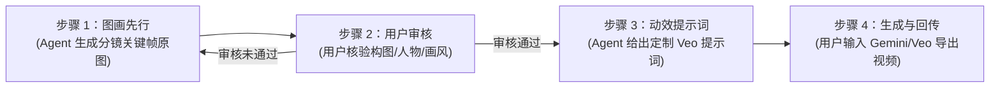

# 本地 Agent 生产铁律：全局视觉风格与人机协作 SOP 规范

> **适用范围**：微电影《第七张罚单》全片 23 镜头视频与图像生成  
> **核心原则**：**画风绝对统一 · 流程标准规范 · 单步审核交付**

---

## 🚨 核心铁律一：视觉画风绝对统一（锁死新海诚动漫写实）

1. **绝对画风锚定（锁定为：新海诚高质感写实动漫 / 影视概念艺术）**：
   * **严禁真人实拍/3D写实化**：严禁把角色渲染成三次元真人实拍皮肤质感或欧美 3D CGI 偶动画风格；
   * **全片基调对齐**：必须与已成功定稿的 `assets/videos/shot_02_lao_liu_scooter_rain.mp4` 和 `assets/videos/shot_01_macro_city_to_lu_yuan_monologue.mp4` 保持完全一致的二次元写实动漫质感（精致手绘感光影、赛璐珞高光、柔和动漫边缘、水彩背景与雨夜霓虹冷暖光）。

2. **每条提示词（Prompt）必带的风格硬性约束咒语**：
   未来提供的所有中英文提示词，必须在前置和后置强行注入以下锁风指令：
   * **中文必带锁**：
     > `【画风严格对齐要求】：必须严格保持与参考图片 100% 完全一致的“新海诚高质感写实动漫/影视概念艺术风格”！严禁改变画风，绝对严禁生成真人实拍质感！人物五官、发型、黑框眼镜及服饰必须与参考图完全一致。`
   * **英文必带锁**：
     > `Strict style consistency: Must strictly maintain the exact same Makoto Shinkai anime realism concept art style as the reference image. Absolutely NO photorealistic human skin, NO live-action film style. Consistent 2D/2.5D stylized anime aesthetics.`

---

## 🛠️ 核心铁律二：逐镜头四步人机协作生产 SOP（严格执行）

为确保每一帧画质与动态完全符合导演要求，后续所有分镜必须严格遵循以下 **四步生产流水线**：

1. **步骤一（图画先行）**：
   * 针对尚未完成分镜图片的镜头，Agent 优先生成 16:9 高清关键帧原图并保存至 `assets/images/`，呈交预览链接。
2. **步骤二（用户审核）**：
   * 用户审核关键帧的构图、人物表情、道具细节及风格一致性。
   * **未通过**：Agent 立即根据用户意见重新生成或调整图片，严禁跳步生成视频。
   * **通过**：进入步骤三。
3. **步骤三（动效提示词输出）**：
   * 仅在图片审核通过后，Agent 方可为该镜头量身定制图生视频的 Gemini / Veo 中英文动态提示词（包含镜头运镜、微表情、流体物理及音画同步细节）。
4. **步骤四（视频生成与回传归档）**：
   * 用户将审核通过的图片作为首帧/参考底图，连同 Prompt 提交至 Gemini / Veo 生成视频；
   * 用户将生成的 MP4 视频保存至 `assets/videos/`，Agent 立即跟进音画校验、对白字幕与无缝拼接入正片序列。

---

## 💬 核心铁律三：交互沟通原则

* **单次单问（One Question at a Time）**：每次回复只向用户确认一个问题，不堆砌多重决策，确保每一步清晰可执行。
* **严禁虚报进展（Zero Hallucination）**：未在本地物理检验到视频文件前，绝不虚构完成状态。
